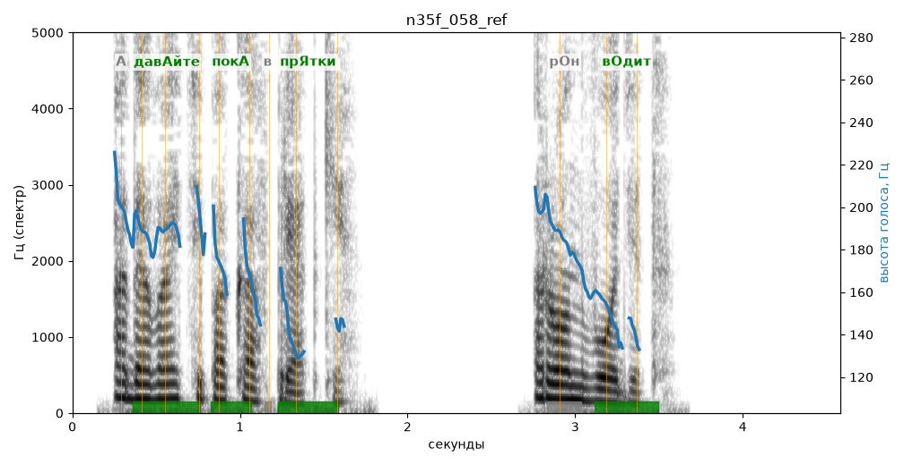

# n35f_058_ref

Голос: **edge:ru-RU-SvetlanaNeural** · длительность 4.6 с
Эталон: А давайте пока в прятки! Рон водит!
Распознано: А давайте пока в прятки. Рон водит.
Слова: все совпали

## Ударения
(где нужно: ruaccent)

| слово | нужно | у голоса | |
|---|---|---|---|
| давайте | давАйте | давАйте | ✓ |
| пока | покА | покА | ✓ |
| прятки | прЯтки | прЯтки | ✓ |
| водит | вОдит | вОдит | ✓ |

## Интонация
- ✓ «а давайте пока в прятки!» — выделено слово «а» (+2.5 пт)
- ✓ «рон водит!» — выделено слово «рон» (+3.3 пт)
- Диапазон голоса 7.2 полутонов (живо), средняя высота 177 Гц

## Паузы и темп
- паузы на своих местах
- Темп 6.1 слога/с (нормально)

_Синяя линия — высота голоса. Над словами заглавная буква — где ударение должно быть; красным — голос поставил не туда (уверенно), оранжевым — возможно._
