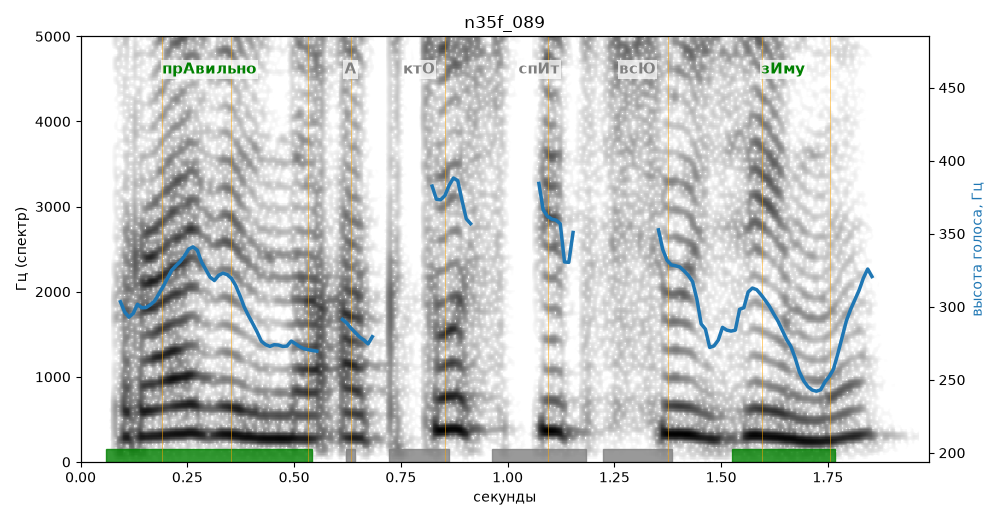

# n35f_089

Голос: **Филя, сборка 35c** · длительность 2.0 с
Эталон: Правильно! А кто спит всю зиму?
Распознано: Правильно, а кто спит всю зиму?
Слова: все совпали

## Ударения
(где нужно: ruaccent)

| слово | нужно | у голоса | |
|---|---|---|---|
| правильно | прАвильно | прАвильно | ✓ |
| зиму | зИму | зИму | ✓ |

## Интонация
- ✗ «правильно!» — восклицание звучит ровно, без эмоции
- ✓ «а кто спит всю зиму?» — вопросительный подъём на слове «кто»
- Диапазон голоса 6.8 полутонов (нормально), средняя высота 301 Гц

## Паузы и темп
- после «правильно!» пауза всего 0.08 с — фразы слипаются
- Темп 5.3 слога/с (нормально)

_Синяя линия — высота голоса. Над словами заглавная буква — где ударение должно быть; красным — голос поставил не туда (уверенно), оранжевым — возможно._
