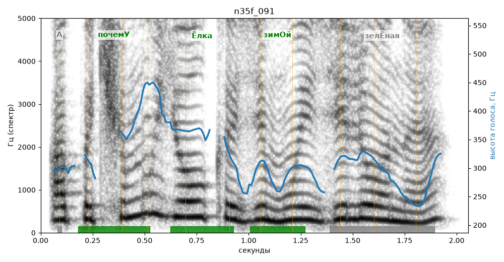

# n35f_091

Голос: **Филя, сборка 35c** · длительность 2.1 с
Эталон: А почему ёлка зимой зелёная?
Распознано: А почему ёлка зимой зеленая?
Слова: все совпали

## Ударения
(где нужно: ruaccent)

| слово | нужно | у голоса | |
|---|---|---|---|
| почему | почемУ | почемУ | ✓ |
| ёлка | Ёлка | Ёлка | ✓ |
| зимой | зимОй | зимОй | ✓ |
| зелёная | зелЁная | — | ? |

## Интонация
- ✗ «а почему ёлка зимой зелёная?» — нет вопросительного подъёма (самое высокое место — «почему», в начале) — звучит как утверждение
- Диапазон голоса 9.5 полутонов (живо), средняя высота 307 Гц

## Паузы и темп
- паузы на своих местах
- Темп 6.1 слога/с (нормально)

_Синяя линия — высота голоса. Над словами заглавная буква — где ударение должно быть; красным — голос поставил не туда (уверенно), оранжевым — возможно._
