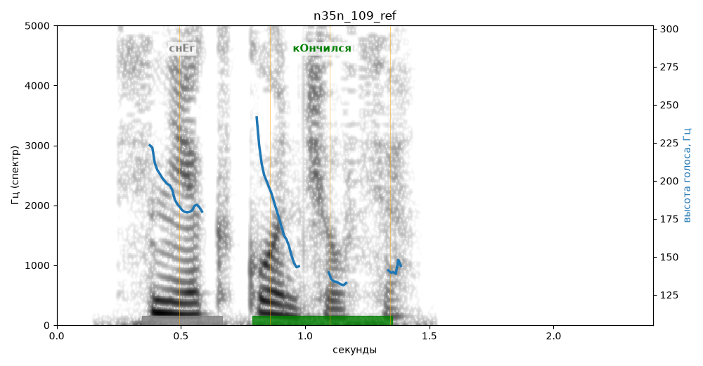

# n35n_109_ref

Голос: **edge:ru-RU-SvetlanaNeural** · длительность 2.4 с
Эталон: Снег кончился.
Распознано: Сник кончился.
Расхождения в словах: «снег» → «сник»

## Ударения
(где нужно: ruaccent)

| слово | нужно | у голоса | |
|---|---|---|---|
| кончился | кОнчился | кОнчился | ✓ |

## Интонация
- ✗ «снег кончился.» — конец фразы не понижается — звучит незаконченно / как перечисление
- Диапазон голоса 8.9 полутонов (живо), средняя высота 180 Гц

## Паузы и темп
- паузы на своих местах
- Темп 4.0 слога/с (нормально)

_Синяя линия — высота голоса. Над словами заглавная буква — где ударение должно быть; красным — голос поставил не туда (уверенно), оранжевым — возможно._
