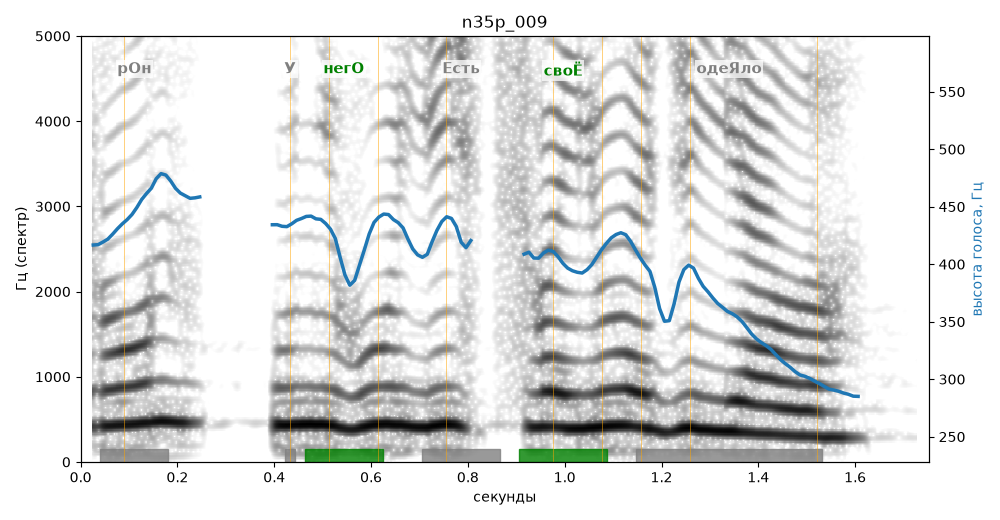

# n35p_009

Голос: **Пик, сборка 35c** · длительность 1.8 с
Эталон: Рон, у него есть своё одеяло.
Распознано: Рон у него есть своё идея.
Расхождения в словах: «одеяло» → «идея»

## Ударения
(где нужно: ruaccent)

| слово | нужно | у голоса | |
|---|---|---|---|
| него | негО | негО | ✓ |
| своё | своЁ | своЁ | ✓ |
| одеяло | одеЯло | — | ? |

## Интонация
- ✓ «рон у него есть своё одеяло.» — конец фразы понижается — звучит законченно
- Диапазон голоса 7.9 полутонов (живо), средняя высота 410 Гц

## Паузы и темп
- паузы на своих местах
- Темп 8.0 слога/с (быстро)

_Синяя линия — высота голоса. Над словами заглавная буква — где ударение должно быть; красным — голос поставил не туда (уверенно), оранжевым — возможно._
