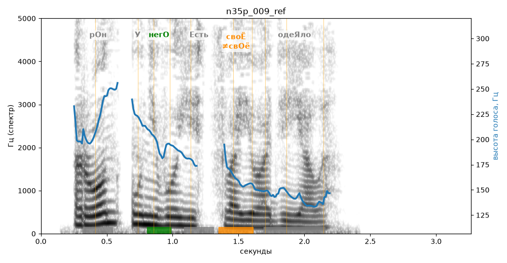

# n35p_009_ref

Голос: **edge:ru-RU-SvetlanaNeural** · длительность 3.3 с
Эталон: Рон, у него есть своё одеяло.
Распознано: Рон у него есть свое одеяло.
Слова: все совпали

## Ударения
(где нужно: ruaccent)

| слово | нужно | у голоса | |
|---|---|---|---|
| него | негО | негО | ✓ |
| своё | своЁ | свОё | ✗? возможно — послушать |
| одеяло | одеЯло | — | ? |

## Интонация
- ✓ «рон у него есть своё одеяло.» — конец фразы понижается — звучит законченно
- Диапазон голоса 10.2 полутонов (живо), средняя высота 179 Гц

## Паузы и темп
- паузы на своих местах
- Темп 6.1 слога/с (нормально)

_Синяя линия — высота голоса. Над словами заглавная буква — где ударение должно быть; красным — голос поставил не туда (уверенно), оранжевым — возможно._
