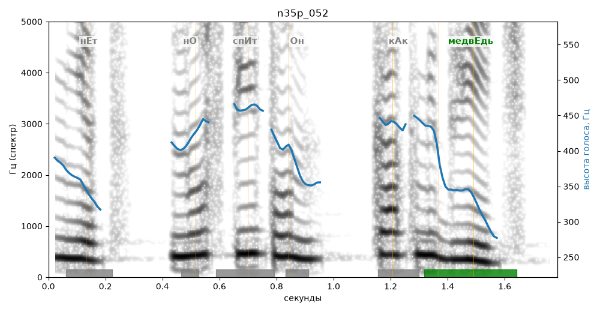

# n35p_052

Голос: **Пик, сборка 35c** · длительность 1.8 с
Эталон: Нет. Но спит он, как медведь.
Распознано: Нет, но с пипом, как мне бить.
Расхождения в словах: «спит он» → «с пипом»; «медведь» → «мне бить»

## Ударения
(где нужно: ruaccent)

| слово | нужно | у голоса | |
|---|---|---|---|
| медведь | медвЕдь | медвЕдь | ✓ |

## Интонация
- ✓ «но спит он как медведь.» — конец фразы понижается — звучит законченно
- Диапазон голоса 6.9 полутонов (нормально), средняя высота 402 Гц

## Паузы и темп
- паузы на своих местах
- Темп 6.4 слога/с (нормально)

_Синяя линия — высота голоса. Над словами заглавная буква — где ударение должно быть; красным — голос поставил не туда (уверенно), оранжевым — возможно._
