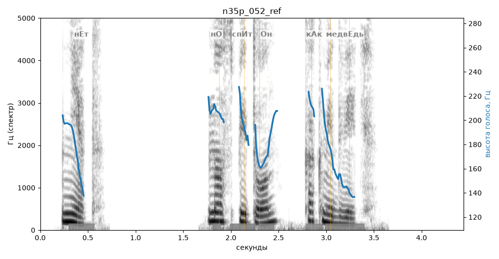

# n35p_052_ref

Голос: **edge:ru-RU-SvetlanaNeural** · длительность 4.4 с
Эталон: Нет. Но спит он, как медведь.
Распознано: Нет. Но спит он, как медведь.
Слова: все совпали

## Ударения
(где нужно: ruaccent)

| слово | нужно | у голоса | |
|---|---|---|---|
| медведь | медвЕдь | мЕдведь | ? не разобрать |

## Интонация
- ✓ «но спит он как медведь.» — конец фразы понижается — звучит законченно
- Диапазон голоса 7.6 полутонов (живо), средняя высота 188 Гц

## Паузы и темп
- паузы на своих местах
- Темп 4.6 слога/с (нормально)

_Синяя линия — высота голоса. Над словами заглавная буква — где ударение должно быть; красным — голос поставил не туда (уверенно), оранжевым — возможно._
