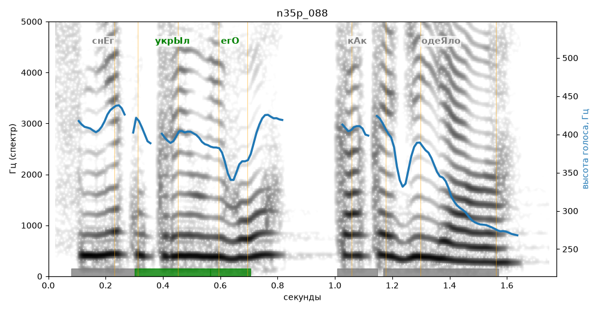

# n35p_088

Голос: **Пик, сборка 35c** · длительность 1.8 с
Эталон: Снег укрыл его, как одеяло.
Распознано: Снегу крым его, как одеяло.
Расхождения в словах: «снег укрыл» → «снегу крым»

## Ударения
(где нужно: ruaccent)

| слово | нужно | у голоса | |
|---|---|---|---|
| укрыл | укрЫл | укрЫл | ✓ |
| его | егО | егО | ✓ |
| одеяло | одеЯло | — | ? |

## Интонация
- ✓ «снег укрыл его как одеяло.» — конец фразы понижается — звучит законченно
- Диапазон голоса 7.6 полутонов (живо), средняя высота 389 Гц

## Паузы и темп
- паузы на своих местах
- Темп 7.6 слога/с (быстро)

_Синяя линия — высота голоса. Над словами заглавная буква — где ударение должно быть; красным — голос поставил не туда (уверенно), оранжевым — возможно._
