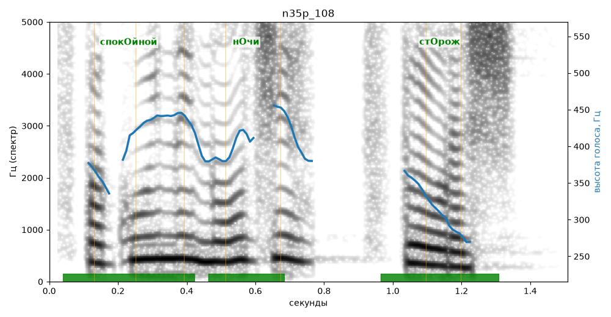

# n35p_108

Голос: **Пик, сборка 35c** · длительность 1.5 с
Эталон: Спокойной ночи, сторож.
Распознано: Спокойной ночи, стыреш.
Расхождения в словах: «сторож» → «стыреш»

## Ударения
(где нужно: ruaccent)

| слово | нужно | у голоса | |
|---|---|---|---|
| спокойной | спокОйной | спокОйной | ✓ |
| ночи | нОчи | нОчи | ✓ |
| сторож | стОрож | стОрож | ✓ |

## Интонация
- ✓ «спокойной ночи сторож.» — конец фразы понижается — звучит законченно
- Диапазон голоса 7.9 полутонов (живо), средняя высота 386 Гц

## Паузы и темп
- паузы на своих местах
- Темп 7.1 слога/с (быстро)

_Синяя линия — высота голоса. Над словами заглавная буква — где ударение должно быть; красным — голос поставил не туда (уверенно), оранжевым — возможно._
