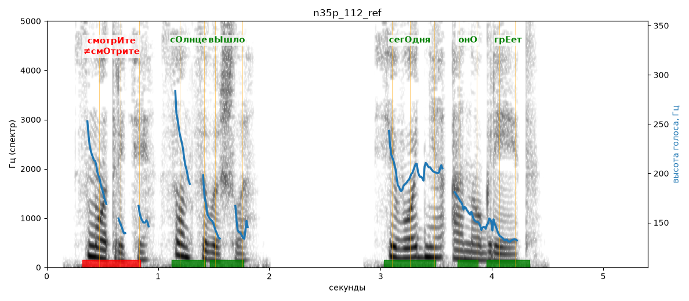

# n35p_112_ref

Голос: **edge:ru-RU-SvetlanaNeural** · длительность 5.4 с
Эталон: Смотрите, солнце вышло! Сегодня оно греет.
Распознано: Смотрите, солнце вышло. Сегодня оно греет.
Слова: все совпали

## Ударения
(где нужно: ruaccent)

| слово | нужно | у голоса | |
|---|---|---|---|
| смотрите | смотрИте | смОтрите | ✗ ОШИБКА |
| солнце | сОлнце | сОлнце | ✓ |
| вышло | вЫшло | вЫшло | ✓ |
| сегодня | сегОдня | сегОдня | ✓ |
| оно | онО | онО | ✓ |
| греет | грЕет | грЕет | ✓ |

## Интонация
- ✓ «смотрите солнце вышло!» — выделено слово «солнце» (+7.0 пт)
- ✓ «сегодня оно греет.» — конец фразы понижается — звучит законченно
- Диапазон голоса 9.5 полутонов (живо), средняя высота 168 Гц

## Паузы и темп
- паузы на своих местах
- Темп 6.2 слога/с (нормально)

_Синяя линия — высота голоса. Над словами заглавная буква — где ударение должно быть; красным — голос поставил не туда (уверенно), оранжевым — возможно._
