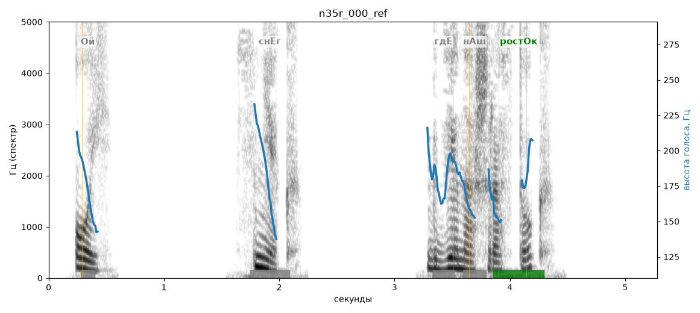

# n35r_000_ref

Голос: **edge:ru-RU-SvetlanaNeural** · длительность 5.3 с
Эталон: Ой! Снег! Где наш росток?
Распознано: Ой! Сник! Где наш расток?
Расхождения в словах: «снег» → «сник»; «росток» → «расток»

## Ударения
(где нужно: ruaccent)

| слово | нужно | у голоса | |
|---|---|---|---|
| росток | ростОк | ростОк | ✓ |

## Интонация
- ✗ «где наш росток?» — конец фразы не понижается — звучит незаконченно / как перечисление
- Диапазон голоса 6.5 полутонов (нормально), средняя высота 179 Гц

## Паузы и темп
- паузы на своих местах
- Темп 4.2 слога/с (нормально)

_Синяя линия — высота голоса. Над словами заглавная буква — где ударение должно быть; красным — голос поставил не туда (уверенно), оранжевым — возможно._
