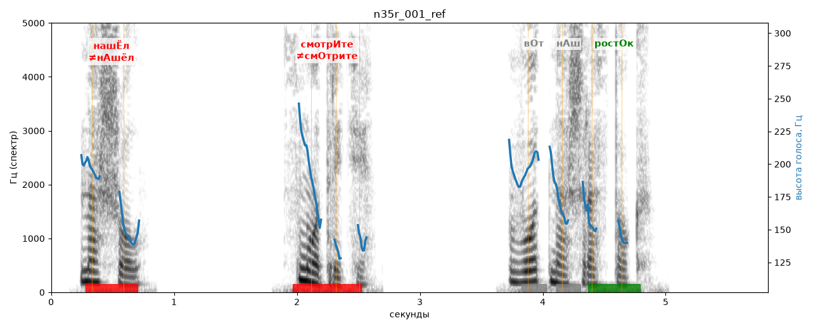

# n35r_001_ref

Голос: **edge:ru-RU-SvetlanaNeural** · длительность 5.8 с
Эталон: Нашёл! Смотрите! Вот наш росток!
Распознано: Нашел. Смотрите. Вот наш росток.
Слова: все совпали

## Ударения
(где нужно: ruaccent)

| слово | нужно | у голоса | |
|---|---|---|---|
| нашёл | нашЁл | нАшёл | ✗ ОШИБКА |
| смотрите | смотрИте | смОтрите | ✗ ОШИБКА |
| росток | ростОк | ростОк | ✓ |

## Интонация
- ✗ «смотрите!» — восклицание звучит ровно, без эмоции
- ✓ «вот наш росток!» — выделено слово «вот» (+3.0 пт)
- Диапазон голоса 7.7 полутонов (живо), средняя высота 176 Гц

## Паузы и темп
- паузы на своих местах
- Темп 4.6 слога/с (нормально)

_Синяя линия — высота голоса. Над словами заглавная буква — где ударение должно быть; красным — голос поставил не туда (уверенно), оранжевым — возможно._
