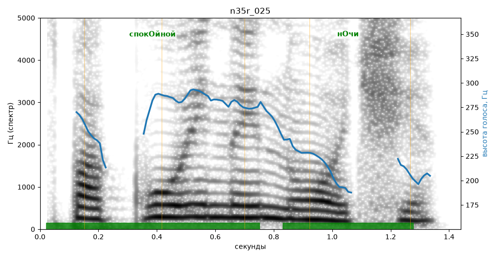

# n35r_025

Голос: **Рон, сборка 35c** · длительность 1.4 с
Эталон: Спокойной ночи!
Распознано: Спокойной ночи.
Слова: все совпали

## Ударения
(где нужно: ruaccent)

| слово | нужно | у голоса | |
|---|---|---|---|
| спокойной | спокОйной | спокОйной | ✓ |
| ночи | нОчи | нОчи | ✓ |

## Интонация
- ✓ «спокойной ночи!» — выделено слово «спокойной» (+2.5 пт)
- Диапазон голоса 6.8 полутонов (нормально), средняя высота 260 Гц

## Паузы и темп
- паузы на своих местах
- Темп 4.0 слога/с (нормально)

_Синяя линия — высота голоса. Над словами заглавная буква — где ударение должно быть; красным — голос поставил не туда (уверенно), оранжевым — возможно._
