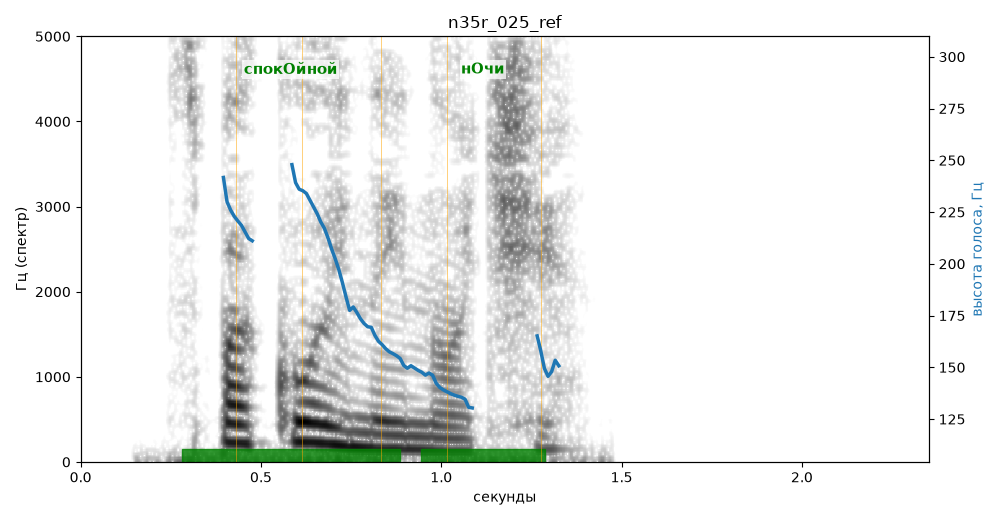

# n35r_025_ref

Голос: **edge:ru-RU-SvetlanaNeural** · длительность 2.4 с
Эталон: Спокойной ночи!
Распознано: Спокойной ночи.
Слова: все совпали

## Ударения
(где нужно: ruaccent)

| слово | нужно | у голоса | |
|---|---|---|---|
| спокойной | спокОйной | спокОйной | ✓ |
| ночи | нОчи | нОчи | ✓ |

## Интонация
- ✓ «спокойной ночи!» — выделено слово «спокойной» (+5.5 пт)
- Диапазон голоса 9.6 полутонов (живо), средняя высота 165 Гц

## Паузы и темп
- паузы на своих местах
- Темп 5.0 слога/с (нормально)

_Синяя линия — высота голоса. Над словами заглавная буква — где ударение должно быть; красным — голос поставил не туда (уверенно), оранжевым — возможно._
