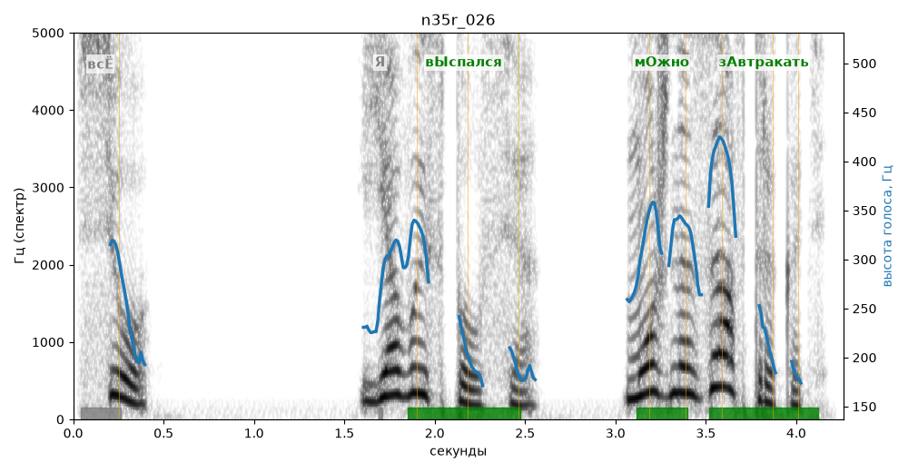

# n35r_026

Голос: **Рон, сборка 35c** · длительность 4.3 с
Эталон: Всё! Я выспался! Можно завтракать?
Распознано: Все. Я выспался. Можно завтракать?
Слова: все совпали

## Ударения
(где нужно: ruaccent)

| слово | нужно | у голоса | |
|---|---|---|---|
| выспался | вЫспался | вЫспался | ✓ |
| можно | мОжно | мОжно | ✓ |
| завтракать | зАвтракать | зАвтракать | ✓ |

## Интонация
- ✓ «я выспался!» — выделено слово «выспался» (+8.7 пт)
- ✓ «можно завтракать?» — вопросительный подъём на слове «завтракать»
- Диапазон голоса 14.1 полутонов (живо), средняя высота 277 Гц

## Паузы и темп
- паузы на своих местах
- Темп 4.5 слога/с (нормально)

_Синяя линия — высота голоса. Над словами заглавная буква — где ударение должно быть; красным — голос поставил не туда (уверенно), оранжевым — возможно._
