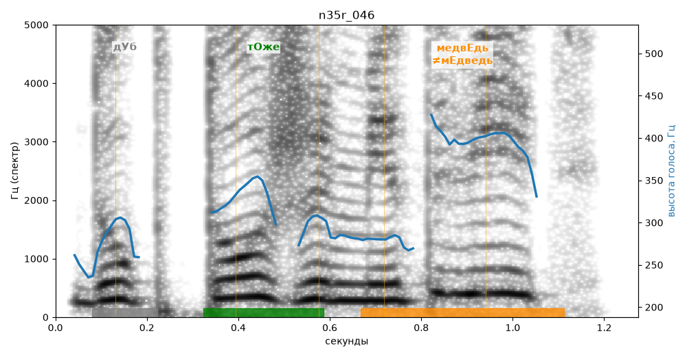

# n35r_046

Голос: **Рон, сборка 35c** · длительность 1.3 с
Эталон: Дуб тоже медведь?
Распознано: Дуб тоже медведь.
Слова: все совпали

## Ударения
(где нужно: ruaccent)

| слово | нужно | у голоса | |
|---|---|---|---|
| тоже | тОже | тОже | ✓ |
| медведь | медвЕдь | мЕдведь | ✗? возможно — послушать |

## Интонация
- ✓ «дуб тоже медведь?» — вопросительный подъём на слове «медведь»
- Диапазон голоса 7.8 полутонов (живо), средняя высота 307 Гц

## Паузы и темп
- паузы на своих местах
- Темп 4.8 слога/с (нормально)

_Синяя линия — высота голоса. Над словами заглавная буква — где ударение должно быть; красным — голос поставил не туда (уверенно), оранжевым — возможно._
