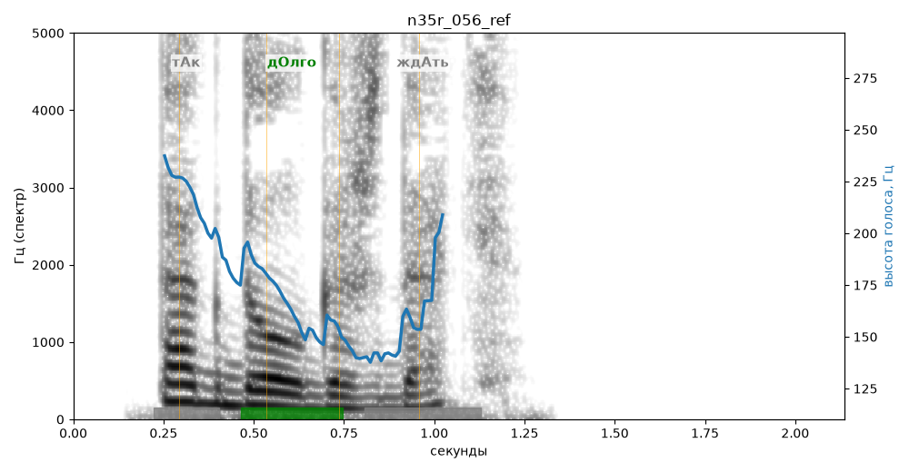

# n35r_056_ref

Голос: **edge:ru-RU-SvetlanaNeural** · длительность 2.1 с
Эталон: Так долго ждать?
Распознано: Так долго ждать?
Слова: все совпали

## Ударения
(где нужно: ruaccent)

| слово | нужно | у голоса | |
|---|---|---|---|
| долго | дОлго | дОлго | ✓ |

## Интонация
- ✓ «так долго ждать?» — вопросительный подъём на слове «так»
- Диапазон голоса 8.4 полутонов (живо), средняя высота 167 Гц

## Паузы и темп
- паузы на своих местах
- Темп 4.4 слога/с (нормально)

_Синяя линия — высота голоса. Над словами заглавная буква — где ударение должно быть; красным — голос поставил не туда (уверенно), оранжевым — возможно._
