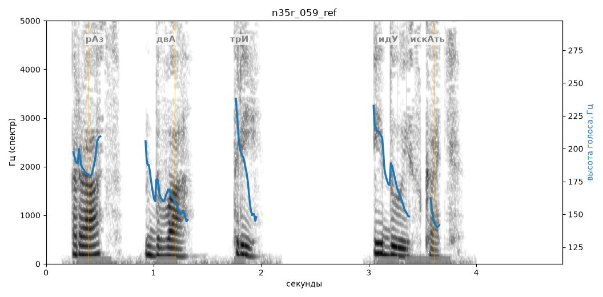

# n35r_059_ref

Голос: **edge:ru-RU-SvetlanaNeural** · длительность 4.8 с
Эталон: Раз, два, три! Иду искать!
Распознано: 1, 2, 3 иду искать
Расхождения в словах: «раз два три» → «1 2 3»

## Ударения
(где нужно: ruaccent)

| слово | нужно | у голоса | |
|---|---|---|---|
| иду | идУ | Иду | ? не разобрать |
| искать | искАть | Искать | ? не разобрать |

## Интонация
- ✗ «раз два три!» — восклицание звучит ровно, без эмоции
- ✗ «иду искать!» — восклицание звучит ровно, без эмоции
- Диапазон голоса 6.7 полутонов (нормально), средняя высота 175 Гц

## Паузы и темп
- паузы на своих местах
- Темп 5.6 слога/с (нормально)

_Синяя линия — высота голоса. Над словами заглавная буква — где ударение должно быть; красным — голос поставил не туда (уверенно), оранжевым — возможно._
