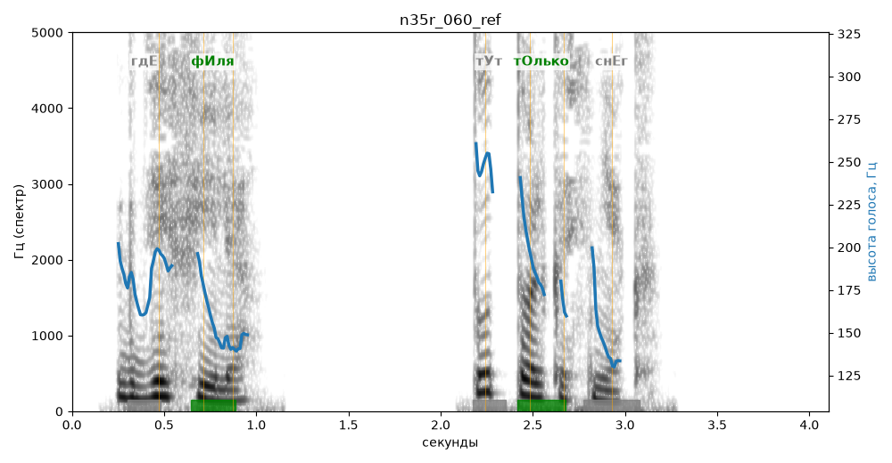

# n35r_060_ref

Голос: **edge:ru-RU-SvetlanaNeural** · длительность 4.1 с
Эталон: Где Филя? Тут только снег!
Распознано: Где Филя? Тут только снег.
Слова: все совпали

## Ударения
(где нужно: ruaccent)

| слово | нужно | у голоса | |
|---|---|---|---|
| филя | фИля | фИля | ✓ |
| только | тОлько | тОлько | ✓ |

## Интонация
- ✗ «где филя?» — конец фразы не понижается — звучит незаконченно / как перечисление
- ✓ «тут только снег!» — выделено слово «тут» (+5.7 пт)
- Диапазон голоса 10.4 полутонов (живо), средняя высота 175 Гц

## Паузы и темп
- паузы на своих местах
- Темп 5.3 слога/с (нормально)

_Синяя линия — высота голоса. Над словами заглавная буква — где ударение должно быть; красным — голос поставил не туда (уверенно), оранжевым — возможно._
