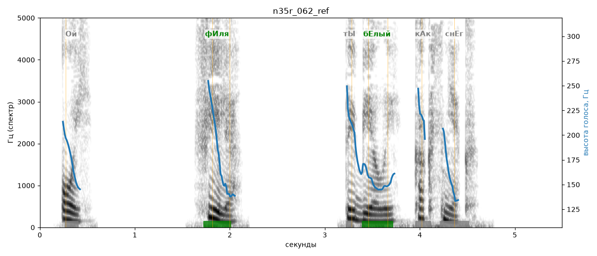

# n35r_062_ref

Голос: **edge:ru-RU-SvetlanaNeural** · длительность 5.5 с
Эталон: Ой! Филя! Ты белый, как снег!
Распознано: Ой! Фили! Ты белый, как снег!
Расхождения в словах: «филя» → «фили»

## Ударения
(где нужно: ruaccent)

| слово | нужно | у голоса | |
|---|---|---|---|
| филя | фИля | фИля | ✓ |
| белый | бЕлый | бЕлый | ✓ |

## Интонация
- ✓ «ты белый как снег!» — выделено слово «как» (+5.8 пт)
- Диапазон голоса 8.7 полутонов (живо), средняя высота 161 Гц

## Паузы и темп
- паузы на своих местах
- Темп 5.5 слога/с (нормально)

_Синяя линия — высота голоса. Над словами заглавная буква — где ударение должно быть; красным — голос поставил не туда (уверенно), оранжевым — возможно._
