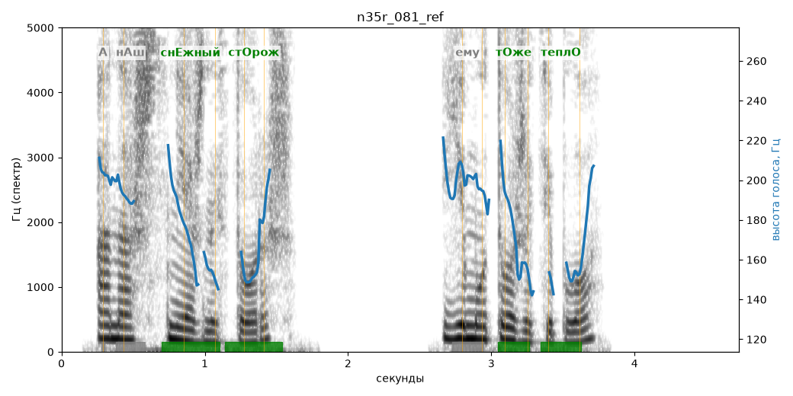

# n35r_081_ref

Голос: **edge:ru-RU-SvetlanaNeural** · длительность 4.7 с
Эталон: А наш снежный сторож? Ему тоже тепло?
Распознано: А наш снежный сторож? Ему тоже тепло?
Слова: все совпали

## Ударения
(где нужно: ruaccent)

| слово | нужно | у голоса | |
|---|---|---|---|
| снежный | снЕжный | снЕжный | ✓ |
| сторож | стОрож | стОрож | ✓ |
| ему | ему | Ему | нет эталона |
| тоже | тОже | тОже | ✓ |
| тепло | теплО | теплО | ✓ |

## Интонация
- ✗ «а наш снежный сторож?» — нет вопросительного подъёма (самое высокое место — «а», в начале) — звучит как утверждение
- ✗ «ему тоже тепло?» — нет вопросительного подъёма (самое высокое место — «ему», в начале) — звучит как утверждение
- Диапазон голоса 6.0 полутонов (нормально), средняя высота 187 Гц

## Паузы и темп
- паузы на своих местах
- Темп 5.5 слога/с (нормально)

_Синяя линия — высота голоса. Над словами заглавная буква — где ударение должно быть; красным — голос поставил не туда (уверенно), оранжевым — возможно._
