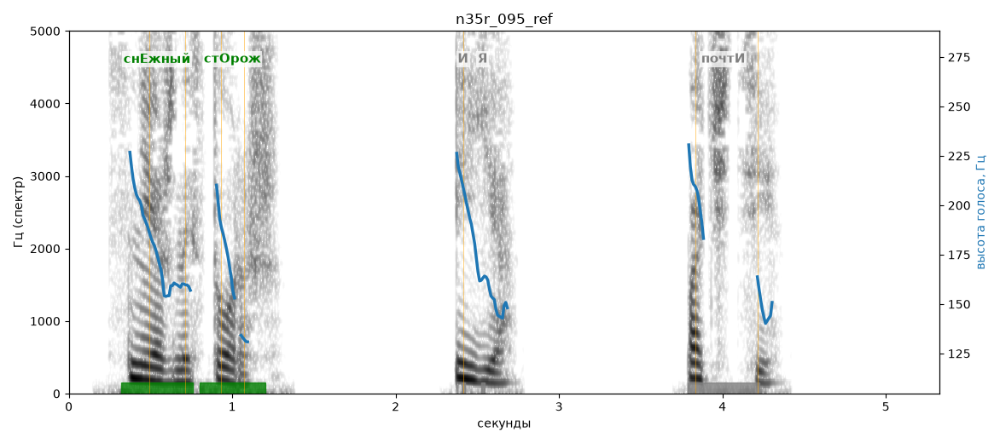

# n35r_095_ref

Голос: **edge:ru-RU-SvetlanaNeural** · длительность 5.3 с
Эталон: Снежный сторож! И я! Почти.
Распознано: снежный сторож. И я. Почти.
Слова: все совпали

## Ударения
(где нужно: ruaccent)

| слово | нужно | у голоса | |
|---|---|---|---|
| снежный | снЕжный | снЕжный | ✓ |
| сторож | стОрож | стОрож | ✓ |
| почти | почтИ | пОчти | ? не разобрать |

## Интонация
- ✗ «снежный сторож!» — восклицание звучит ровно, без эмоции
- Диапазон голоса 7.6 полутонов (живо), средняя высота 164 Гц

## Паузы и темп
- паузы на своих местах
- Темп 4.8 слога/с (нормально)

_Синяя линия — высота голоса. Над словами заглавная буква — где ударение должно быть; красным — голос поставил не туда (уверенно), оранжевым — возможно._
