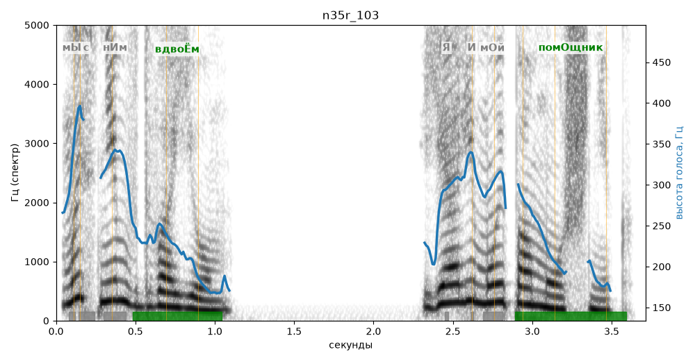

# n35r_103

Голос: **Рон, сборка 35c** · длительность 3.7 с
Эталон: Мы с ним вдвоём. Я и мой помощник.
Распознано: Мы с ним вдвоем. Я и мой помощник.
Слова: все совпали

## Ударения
(где нужно: ruaccent)

| слово | нужно | у голоса | |
|---|---|---|---|
| вдвоём | вдвоЁм | вдвоЁм | ✓ |
| помощник | помОщник | помОщник | ✓ |

## Интонация
- ✓ «мы с ним вдвоём.» — конец фразы понижается — звучит законченно
- ✓ «я и мой помощник.» — конец фразы понижается — звучит законченно
- Диапазон голоса 12.0 полутонов (живо), средняя высота 247 Гц

## Паузы и темп
- паузы на своих местах
- Темп 4.7 слога/с (нормально)

_Синяя линия — высота голоса. Над словами заглавная буква — где ударение должно быть; красным — голос поставил не туда (уверенно), оранжевым — возможно._
