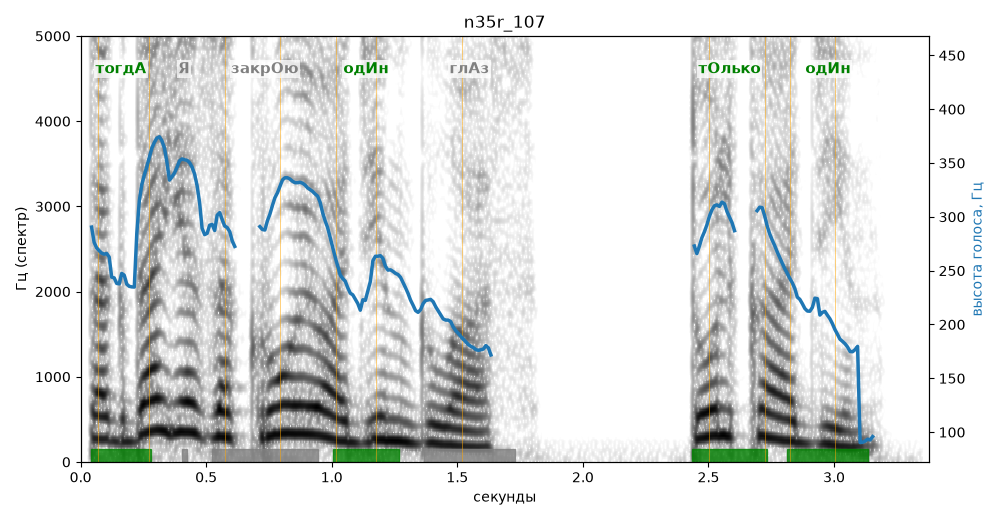

# n35r_107

Голос: **Рон, сборка 35c** · длительность 3.4 с
Эталон: Тогда я закрою один глаз. Только один.
Распознано: Тогда я закрою один глаз. Только один.
Слова: все совпали

## Ударения
(где нужно: ruaccent)

| слово | нужно | у голоса | |
|---|---|---|---|
| тогда | тогдА | тогдА | ✓ |
| закрою | закрОю | — | ? |
| один | одИн | одИн | ✓ |
| только | тОлько | тОлько | ✓ |
| один | одИн | одИн | ✓ |

## Интонация
- ✓ «тогда я закрою один глаз.» — конец фразы понижается — звучит законченно
- ✓ «только один.» — конец фразы понижается — звучит законченно
- Диапазон голоса 11.9 полутонов (живо), средняя высота 262 Гц

## Паузы и темп
- паузы на своих местах
- Темп 4.6 слога/с (нормально)

_Синяя линия — высота голоса. Над словами заглавная буква — где ударение должно быть; красным — голос поставил не туда (уверенно), оранжевым — возможно._
