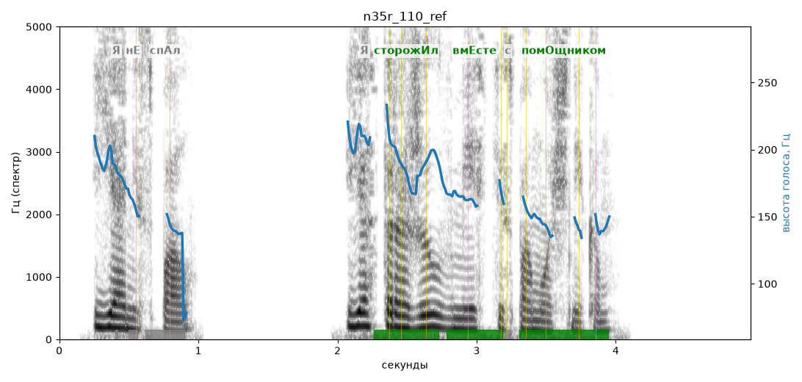

# n35r_110_ref

Голос: **edge:ru-RU-SvetlanaNeural** · длительность 5.0 с
Эталон: Я не спал! Я сторожил вместе с помощником!
Распознано: Я не спал. Я сторожил вместе с помощником.
Слова: все совпали

## Ударения
(где нужно: ruaccent)

| слово | нужно | у голоса | |
|---|---|---|---|
| сторожил | сторожИл | сторожИл | ✓ |
| вместе | вмЕсте | вмЕсте | ✓ |
| помощником | помОщником | помОщником | ✓ |

## Интонация
- ✓ «я сторожил вместе с помощником!» — выделено слово «сторожил» (+2.5 пт)
- Диапазон голоса 7.4 полутонов (живо), средняя высота 167 Гц

## Паузы и темп
- паузы на своих местах
- Темп 5.3 слога/с (нормально)

_Синяя линия — высота голоса. Над словами заглавная буква — где ударение должно быть; красным — голос поставил не туда (уверенно), оранжевым — возможно._
