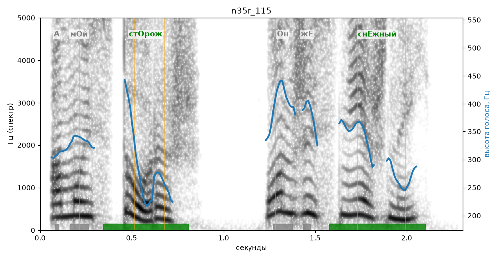

# n35r_115

Голос: **Рон, сборка 35c** · длительность 2.3 с
Эталон: А мой сторож? Он же снежный!
Распознано: А мой сторож, он же снежный.
Слова: все совпали

## Ударения
(где нужно: ruaccent)

| слово | нужно | у голоса | |
|---|---|---|---|
| сторож | стОрож | стОрож | ✓ |
| снежный | снЕжный | снЕжный | ✓ |

## Интонация
- ✗ «а мой сторож?» — нет вопросительного подъёма (самое высокое место — «мой», в начале) — звучит как утверждение
- ✗ «он же снежный!» — восклицание звучит ровно, без эмоции
- Диапазон голоса 10.8 полутонов (живо), средняя высота 329 Гц

## Паузы и темп
- паузы на своих местах
- Темп 5.1 слога/с (нормально)

_Синяя линия — высота голоса. Над словами заглавная буква — где ударение должно быть; красным — голос поставил не туда (уверенно), оранжевым — возможно._
