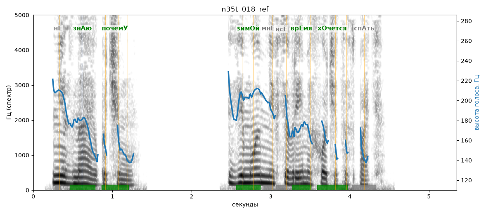

# n35t_018_ref

Голос: **edge:ru-RU-SvetlanaNeural** · длительность 5.4 с
Эталон: Не знаю почему. Зимой мне всё время хочется спать.
Распознано: Не знаю почему. Зимой мне все время хочется спать.
Слова: все совпали

## Ударения
(где нужно: ruaccent)

| слово | нужно | у голоса | |
|---|---|---|---|
| знаю | знАю | знАю | ✓ |
| почему | почемУ | почемУ | ✓ |
| зимой | зимОй | зимОй | ✓ |
| время | врЕмя | врЕмя | ✓ |
| хочется | хОчется | хОчется | ✓ |

## Интонация
- ✓ «не знаю почему.» — конец фразы понижается — звучит законченно
- ✓ «зимой мне всё время хочется спать.» — конец фразы понижается — звучит законченно
- Диапазон голоса 7.0 полутонов (живо), средняя высота 178 Гц

## Паузы и темп
- паузы на своих местах
- Темп 5.6 слога/с (нормально)

_Синяя линия — высота голоса. Над словами заглавная буква — где ударение должно быть; красным — голос поставил не туда (уверенно), оранжевым — возможно._
