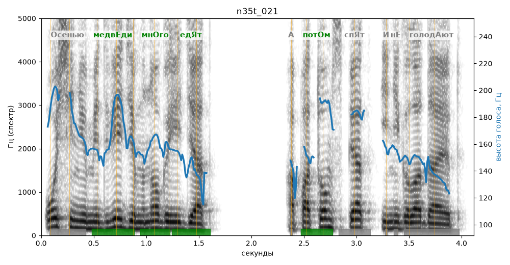

# n35t_021

Голос: **Топа, сборка 35c** · длительность 4.1 с
Эталон: Осенью медведи много едят. А потом спят и не голодают.
Распознано: осенью медведем много едят, а потом спят и не голодают.
Расхождения в словах: «медведи» → «медведем»

## Ударения
(где нужно: ruaccent)

| слово | нужно | у голоса | |
|---|---|---|---|
| осенью | Осенью | — | ? |
| медведи | медвЕди | медвЕди | ✓ |
| много | мнОго | мнОго | ✓ |
| едят | едЯт | едЯт | ✓ |
| потом | потОм | потОм | ✓ |
| голодают | голодАют | — | ? |

## Интонация
- ✓ «осенью медведи много едят.» — конец фразы понижается — звучит законченно
- ✓ «а потом спят и не голодают.» — конец фразы понижается — звучит законченно
- Диапазон голоса 6.6 полутонов (нормально), средняя высота 155 Гц

## Паузы и темп
- паузы на своих местах
- Темп 5.7 слога/с (нормально)

_Синяя линия — высота голоса. Над словами заглавная буква — где ударение должно быть; красным — голос поставил не туда (уверенно), оранжевым — возможно._
