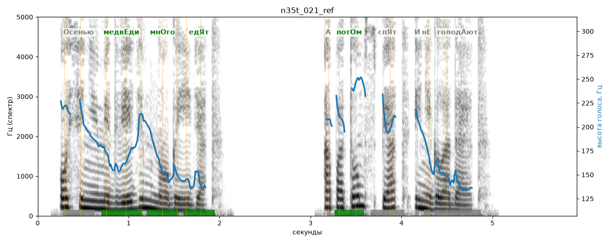

# n35t_021_ref

Голос: **edge:ru-RU-SvetlanaNeural** · длительность 5.9 с
Эталон: Осенью медведи много едят. А потом спят и не голодают.
Распознано: Оси ними две демного едят. А потом спят и не гладают.
Расхождения в словах: «осенью медведи много» → «оси ними две демного»; «голодают» → «гладают»

## Ударения
(где нужно: ruaccent)

| слово | нужно | у голоса | |
|---|---|---|---|
| осенью | Осенью | — | ? |
| медведи | медвЕди | медвЕди | ✓ |
| много | мнОго | мнОго | ✓ |
| едят | едЯт | едЯт | ✓ |
| потом | потОм | потОм | ✓ |
| голодают | голодАют | — | ? |

## Интонация
- ✓ «осенью медведи много едят.» — конец фразы понижается — звучит законченно
- ✓ «а потом спят и не голодают.» — конец фразы понижается — звучит законченно
- Диапазон голоса 9.6 полутонов (живо), средняя высота 174 Гц

## Паузы и темп
- паузы на своих местах
- Темп 5.4 слога/с (нормально)

_Синяя линия — высота голоса. Над словами заглавная буква — где ударение должно быть; красным — голос поставил не туда (уверенно), оранжевым — возможно._
