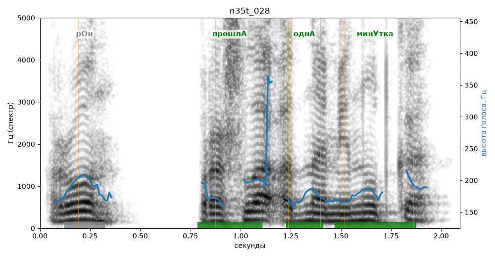

# n35t_028

Голос: **Топа, сборка 35c** · длительность 2.1 с
Эталон: Рон, прошла одна минутка!
Распознано: Рон, прошла 1 минутка.
Расхождения в словах: «одна» → «1»

## Ударения
(где нужно: ruaccent)

| слово | нужно | у голоса | |
|---|---|---|---|
| прошла | прошлА | прошлА | ✓ |
| одна | однА | однА | ✓ |
| минутка | минУтка | минУтка | ✓ |

## Интонация
- ✓ «рон прошла одна минутка!» — выделено слово «прошла» (+2.0 пт)
- Диапазон голоса 4.0 полутонов (монотонно, как робот), средняя высота 181 Гц

## Паузы и темп
- паузы на своих местах
- Темп 6.2 слога/с (нормально)

_Синяя линия — высота голоса. Над словами заглавная буква — где ударение должно быть; красным — голос поставил не туда (уверенно), оранжевым — возможно._
