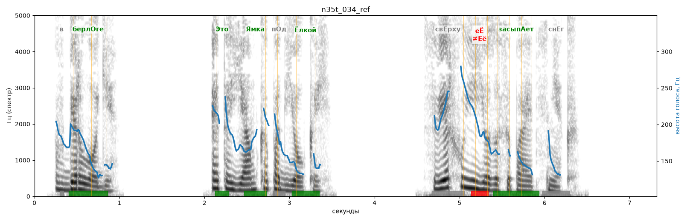

# n35t_034_ref

Голос: **edge:ru-RU-SvetlanaNeural** · длительность 7.3 с
Эталон: В берлоге. Это ямка под ёлкой. Сверху её засыпает снег.
Распознано: В бирлоге. Это ямко подъелкой. Сверху ее засыпает снег.
Расхождения в словах: «берлоге» → «бирлоге»; «ямка под елкой» → «ямко подъелкой»

## Ударения
(где нужно: ruaccent)

| слово | нужно | у голоса | |
|---|---|---|---|
| берлоге | берлОге | берлОге | ✓ |
| это | Это | Это | ✓ |
| ямка | Ямка | Ямка | ✓ |
| ёлкой | Ёлкой | Ёлкой | ✓ |
| сверху | свЕрху | сверхУ | ? не разобрать |
| её | еЁ | Её | ✗ ОШИБКА |
| засыпает | засыпАет | засыпАет | ✓ |

## Интонация
- ✓ «в берлоге.» — конец фразы понижается — звучит законченно
- ✓ «это ямка под ёлкой.» — конец фразы понижается — звучит законченно
- ✓ «сверху её засыпает снег.» — конец фразы понижается — звучит законченно
- Диапазон голоса 9.8 полутонов (живо), средняя высота 170 Гц

## Паузы и темп
- паузы на своих местах
- Темп 5.9 слога/с (нормально)

_Синяя линия — высота голоса. Над словами заглавная буква — где ударение должно быть; красным — голос поставил не туда (уверенно), оранжевым — возможно._
