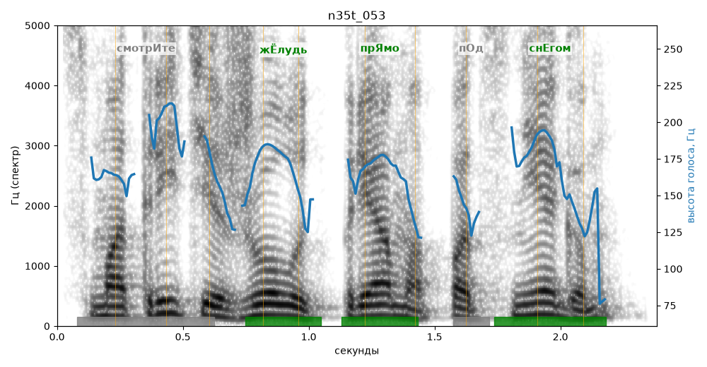

# n35t_053

Голос: **Топа, сборка 35c** · длительность 2.4 с
Эталон: Смотрите! Жёлудь! Прямо под снегом!
Распознано: Смотрите, желают прямо под снегом.
Расхождения в словах: «желудь» → «желают»

## Ударения
(где нужно: ruaccent)

| слово | нужно | у голоса | |
|---|---|---|---|
| смотрите | смотрИте | смотритЕ | ? не разобрать |
| жёлудь | жЁлудь | жЁлудь | ✓ |
| прямо | прЯмо | прЯмо | ✓ |
| снегом | снЕгом | снЕгом | ✓ |

## Интонация
- ✓ «смотрите!» — выделено слово «смотрите» (+3.7 пт)
- ✓ «прямо под снегом!» — выделено слово «снегом» (+2.3 пт)
- Диапазон голоса 8.3 полутонов (живо), средняя высота 165 Гц

## Паузы и темп
- после «смотрите!» пауза всего 0.12 с — фразы слипаются
- после «жёлудь!» пауза всего 0.08 с — фразы слипаются
- Темп 4.8 слога/с (нормально)

_Синяя линия — высота голоса. Над словами заглавная буква — где ударение должно быть; красным — голос поставил не туда (уверенно), оранжевым — возможно._
