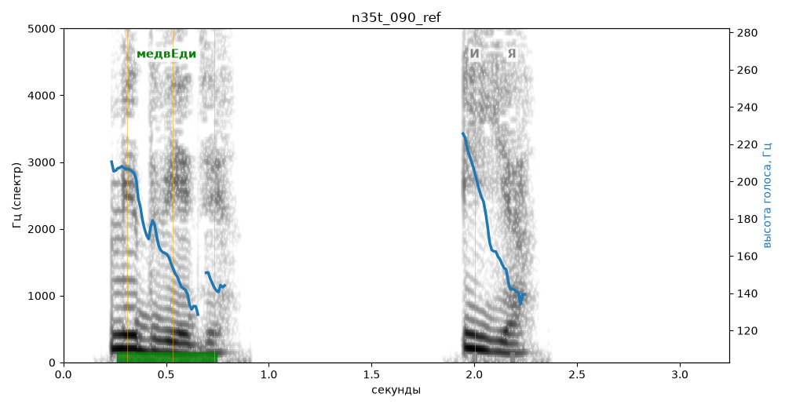

# n35t_090_ref

Голос: **edge:ru-RU-SvetlanaNeural** · длительность 3.2 с
Эталон: Медведи. И я.
Распознано: Медведя. И я.
Расхождения в словах: «медведи» → «медведя»

## Ударения
(где нужно: ruaccent)

| слово | нужно | у голоса | |
|---|---|---|---|
| медведи | медвЕди | медвЕди | ✓ |

## Интонация
- ✗ «медведи.» — конец фразы не понижается — звучит незаконченно / как перечисление
- Диапазон голоса 7.9 полутонов (живо), средняя высота 162 Гц

## Паузы и темп
- паузы на своих местах
- Темп 7.6 слога/с (быстро)

_Синяя линия — высота голоса. Над словами заглавная буква — где ударение должно быть; красным — голос поставил не туда (уверенно), оранжевым — возможно._
