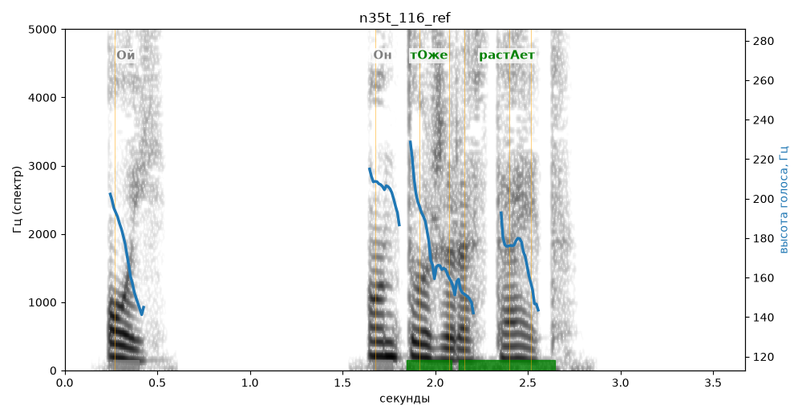

# n35t_116_ref

Голос: **edge:ru-RU-SvetlanaNeural** · длительность 3.7 с
Эталон: Ой. Он тоже растает?
Распознано: Ой! Он тоже растает.
Слова: все совпали

## Ударения
(где нужно: ruaccent)

| слово | нужно | у голоса | |
|---|---|---|---|
| тоже | тОже | тОже | ✓ |
| растает | растАет | растАет | ✓ |

## Интонация
- ✓ «он тоже растает?» — вопросительный подъём на слове «он»
- Диапазон голоса 6.3 полутонов (нормально), средняя высота 176 Гц

## Паузы и темп
- паузы на своих местах
- Темп 6.2 слога/с (нормально)

_Синяя линия — высота голоса. Над словами заглавная буква — где ударение должно быть; красным — голос поставил не туда (уверенно), оранжевым — возможно._
