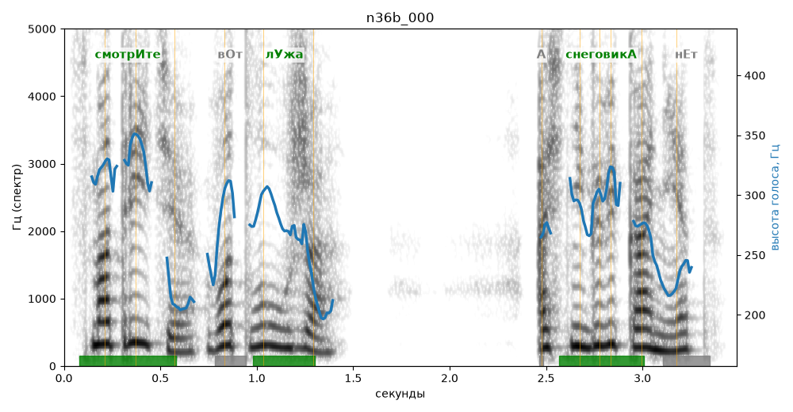

# n36b_000

Голос: **Барсик, сборка 36d** · длительность 3.5 с
Эталон: Смотрите, вот лужа! А снеговика нет!
Распознано: Смотрите, вот лужа. А сниговиканец.
Расхождения в словах: «снеговика нет» → «сниговиканец»

## Ударения
(где нужно: ruaccent)

| слово | нужно | у голоса | |
|---|---|---|---|
| смотрите | смотрИте | смотрИте | ✓ |
| лужа | лУжа | лУжа | ✓ |
| снеговика | снеговикА | снеговикА | ✓ |

## Интонация
- ✓ «смотрите вот лужа!» — выделено слово «смотрите» (+2.9 пт)
- ✗ «а снеговика нет!» — восклицание звучит ровно, без эмоции
- Диапазон голоса 8.3 полутонов (живо), средняя высота 275 Гц

## Паузы и темп
- паузы на своих местах
- Темп 6.3 слога/с (нормально)

_Синяя линия — высота голоса. Над словами заглавная буква — где ударение должно быть; красным — голос поставил не туда (уверенно), оранжевым — возможно._
