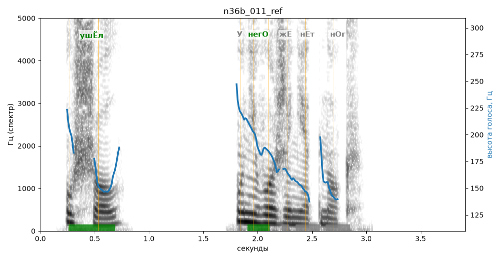

# n36b_011_ref

Голос: **edge:ru-RU-SvetlanaNeural** · длительность 3.9 с
Эталон: Ушёл? У него же нет ног!
Распознано: ушел? у него же нет ног
Слова: все совпали

## Ударения
(где нужно: ruaccent)

| слово | нужно | у голоса | |
|---|---|---|---|
| ушёл | ушЁл | ушЁл | ✓ |
| него | негО | негО | ✓ |

## Интонация
- ✓ «у него же нет ног!» — выделено слово «у» (+4.4 пт)
- Диапазон голоса 7.5 полутонов (живо), средняя высота 167 Гц

## Паузы и темп
- паузы на своих местах
- Темп 5.5 слога/с (нормально)

_Синяя линия — высота голоса. Над словами заглавная буква — где ударение должно быть; красным — голос поставил не туда (уверенно), оранжевым — возможно._
