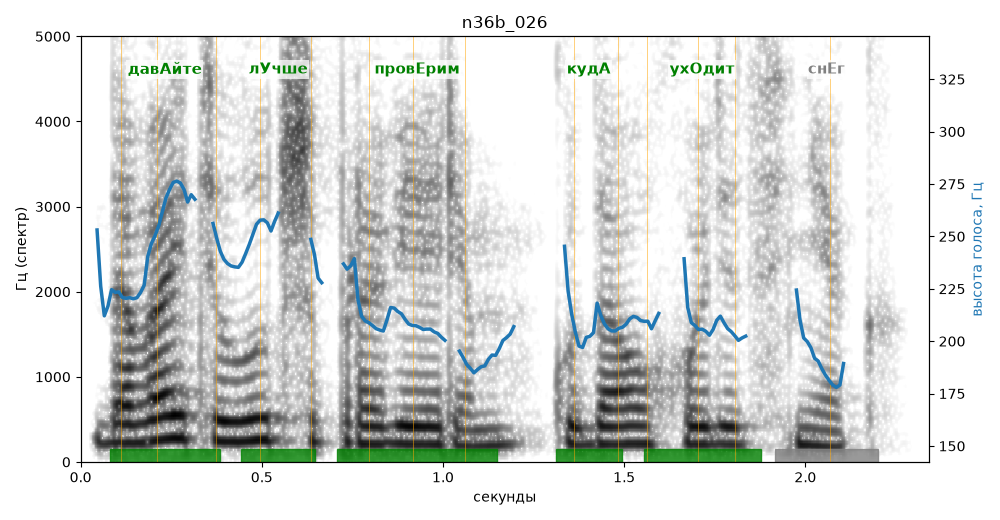

# n36b_026

Голос: **Барсик, сборка 36d** · длительность 2.3 с
Эталон: Давайте лучше проверим, куда уходит снег.
Распознано: Давайте лучше проверим, куда уходит снег.
Слова: все совпали

## Ударения
(где нужно: ruaccent)

| слово | нужно | у голоса | |
|---|---|---|---|
| давайте | давАйте | давАйте | ✓ |
| лучше | лУчше | лУчше | ✓ |
| проверим | провЕрим | провЕрим | ✓ |
| куда | кудА | кудА | ✓ |
| уходит | ухОдит | ухОдит | ✓ |

## Интонация
- ✓ «давайте лучше проверим куда уходит снег.» — конец фразы понижается — звучит законченно
- Диапазон голоса 6.1 полутонов (нормально), средняя высота 210 Гц

## Паузы и темп
- паузы на своих местах
- Темп 7.2 слога/с (быстро)

_Синяя линия — высота голоса. Над словами заглавная буква — где ударение должно быть; красным — голос поставил не туда (уверенно), оранжевым — возможно._
