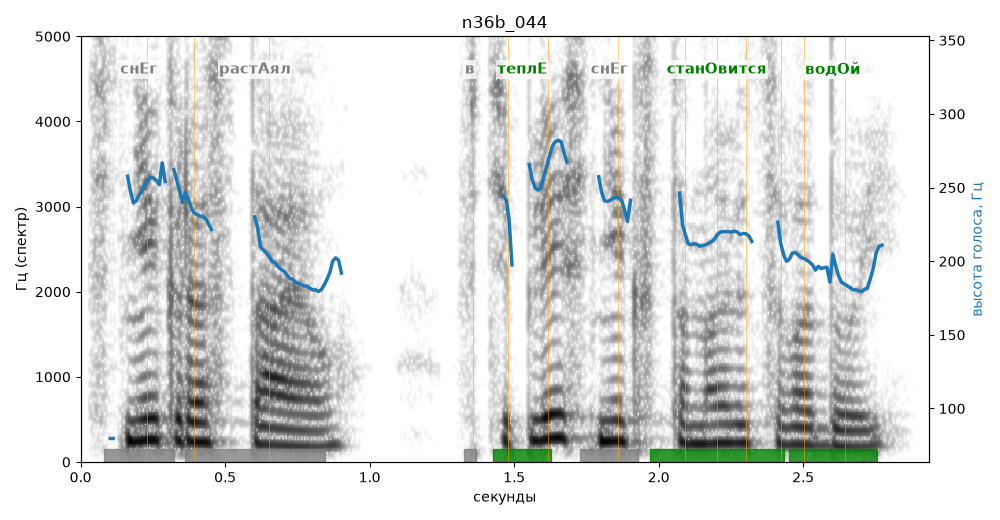

# n36b_044

Голос: **Барсик, сборка 36d** · длительность 2.9 с
Эталон: Снег растаял. В тепле снег становится водой.
Распознано: Сник растаял, в тепле снег становится водой.
Расхождения в словах: «снег» → «сник»

## Ударения
(где нужно: ruaccent)

| слово | нужно | у голоса | |
|---|---|---|---|
| растаял | растАял | — | ? |
| тепле | теплЕ | теплЕ | ✓ |
| становится | станОвится | станОвится | ✓ |
| водой | водОй | водОй | ✓ |

## Интонация
- ✓ «снег растаял.» — конец фразы понижается — звучит законченно
- ✓ «в тепле снег становится водой.» — конец фразы понижается — звучит законченно
- Диапазон голоса 6.7 полутонов (нормально), средняя высота 213 Гц

## Паузы и темп
- паузы на своих местах
- Темп 5.9 слога/с (нормально)

_Синяя линия — высота голоса. Над словами заглавная буква — где ударение должно быть; красным — голос поставил не туда (уверенно), оранжевым — возможно._
