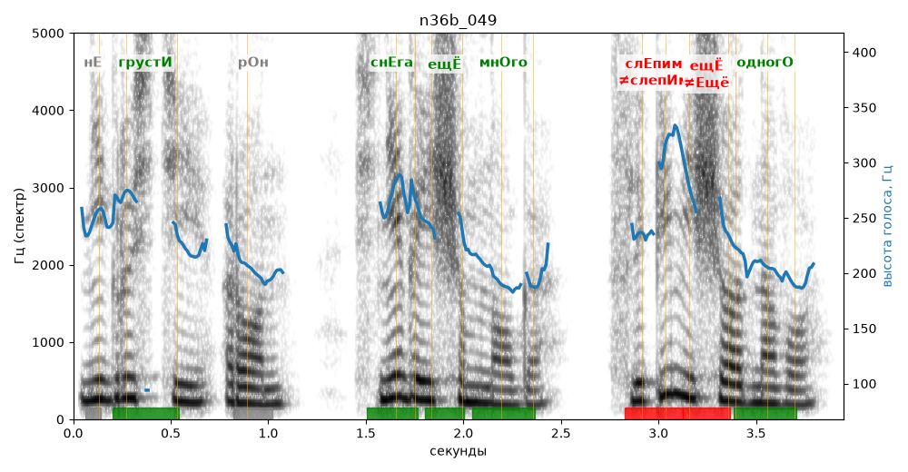

# n36b_049

Голос: **Барсик, сборка 36d** · длительность 3.9 с
Эталон: Не грусти, Рон. Снега ещё много. Слепим ещё одного!
Распознано: Не грусти, Рон, снега еще много. Слепи еще одного.
Расхождения в словах: «слепим» → «слепи»

## Ударения
(где нужно: ruaccent)

| слово | нужно | у голоса | |
|---|---|---|---|
| грусти | грустИ | грустИ | ✓ |
| снега | снЕга | снЕга | ✓ |
| ещё | ещЁ | ещЁ | ✓ |
| много | мнОго | мнОго | ✓ |
| слепим | слЕпим | слепИм | ✗ ОШИБКА |
| ещё | ещЁ | Ещё | ✗ ОШИБКА |
| одного | одногО | одногО | ✓ |

## Интонация
- ✓ «не грусти рон.» — конец фразы понижается — звучит законченно
- ✓ «снега ещё много.» — конец фразы понижается — звучит законченно
- ✗ «слепим ещё одного!» — восклицание звучит ровно, без эмоции
- Диапазон голоса 8.1 полутонов (живо), средняя высота 222 Гц

## Паузы и темп
- паузы на своих местах
- Темп 7.0 слога/с (быстро)

_Синяя линия — высота голоса. Над словами заглавная буква — где ударение должно быть; красным — голос поставил не туда (уверенно), оранжевым — возможно._
