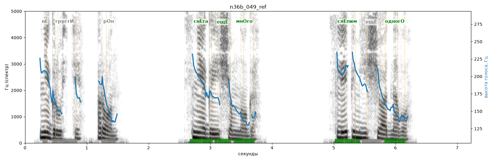

# n36b_049_ref

Голос: **edge:ru-RU-SvetlanaNeural** · длительность 7.2 с
Эталон: Не грусти, Рон. Снега ещё много. Слепим ещё одного!
Распознано: Не грусти, Рон. Снега еще много. Слепим еще одного.
Слова: все совпали

## Ударения
(где нужно: ruaccent)

| слово | нужно | у голоса | |
|---|---|---|---|
| грусти | грустИ | грУсти | ? не разобрать |
| снега | снЕга | снЕга | ✓ |
| ещё | ещЁ | ещЁ | ✓ |
| много | мнОго | мнОго | ✓ |
| слепим | слЕпим | слЕпим | ✓ |
| ещё | ещЁ | Ещё | ? не разобрать |
| одного | одногО | одногО | ✓ |

## Интонация
- ✗ «не грусти рон.» — конец фразы не понижается — звучит незаконченно / как перечисление
- ✓ «снега ещё много.» — конец фразы понижается — звучит законченно
- ✓ «слепим ещё одного!» — выделено слово «слепим» (+2.2 пт)
- Диапазон голоса 7.9 полутонов (живо), средняя высота 170 Гц

## Паузы и темп
- паузы на своих местах
- Темп 5.7 слога/с (нормально)

_Синяя линия — высота голоса. Над словами заглавная буква — где ударение должно быть; красным — голос поставил не туда (уверенно), оранжевым — возможно._
