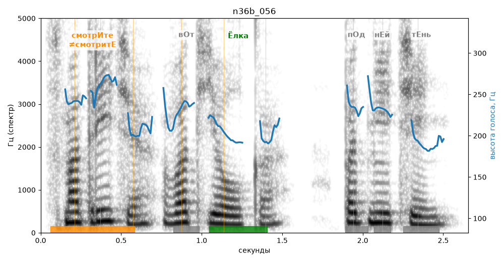

# n36b_056

Голос: **Барсик, сборка 36d** · длительность 2.7 с
Эталон: Смотрите, вот ёлка. Под ней тень.
Распознано: Смотрите, в отъеме поднятень.
Расхождения в словах: «вот елка под ней тень» → «в отъеме поднятень»

## Ударения
(где нужно: ruaccent)

| слово | нужно | у голоса | |
|---|---|---|---|
| смотрите | смотрИте | смотритЕ | ✗? возможно — послушать |
| ёлка | Ёлка | Ёлка | ✓ |

## Интонация
- ✓ «смотрите вот ёлка.» — конец фразы понижается — звучит законченно
- ✓ «под ней тень.» — конец фразы понижается — звучит законченно
- Диапазон голоса 6.2 полутонов (нормально), средняя высота 223 Гц

## Паузы и темп
- паузы на своих местах
- Темп 5.3 слога/с (нормально)

_Синяя линия — высота голоса. Над словами заглавная буква — где ударение должно быть; красным — голос поставил не туда (уверенно), оранжевым — возможно._
