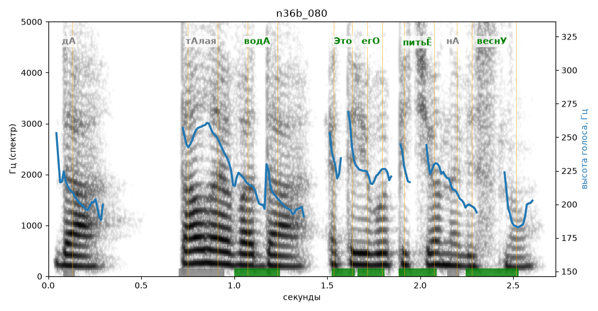

# n36b_080

Голос: **Барсик, сборка 36d** · длительность 2.7 с
Эталон: Да. Талая вода — это его питьё на весну.
Распознано: Да, талая вода – это его петёно весну.
Расхождения в словах: «питье на» → «петено»

## Ударения
(где нужно: ruaccent)

| слово | нужно | у голоса | |
|---|---|---|---|
| талая | тАлая | — | ? |
| вода | водА | водА | ✓ |
| это | Это | Это | ✓ |
| его | егО | егО | ✓ |
| питьё | питьЁ | питьЁ | ✓ |
| весну | веснУ | веснУ | ✓ |

## Интонация
- ✓ «талая вода это его питьё на весну.» — конец фразы понижается — звучит законченно
- Диапазон голоса 5.1 полутонов (нормально), средняя высота 217 Гц

## Паузы и темп
- паузы на своих местах
- Темп 8.7 слога/с (быстро)

_Синяя линия — высота голоса. Над словами заглавная буква — где ударение должно быть; красным — голос поставил не туда (уверенно), оранжевым — возможно._
