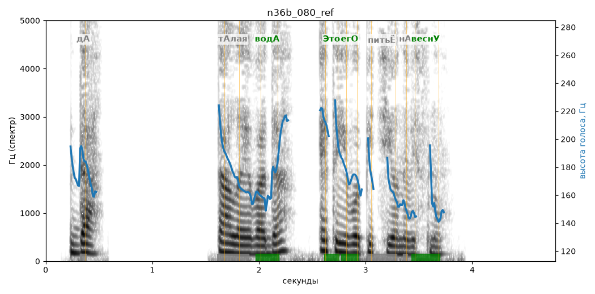

# n36b_080_ref

Голос: **edge:ru-RU-SvetlanaNeural** · длительность 4.8 с
Эталон: Да. Талая вода — это его питьё на весну.
Распознано: Да. Талая вода, это его питье на весну.
Слова: все совпали

## Ударения
(где нужно: ruaccent)

| слово | нужно | у голоса | |
|---|---|---|---|
| талая | тАлая | — | ? |
| вода | водА | водА | ✓ |
| это | Это | Это | ✓ |
| его | егО | егО | ✓ |
| питьё | питьЁ | пИтьё | ? не разобрать |
| весну | веснУ | веснУ | ✓ |

## Интонация
- ✓ «талая вода это его питьё на весну.» — конец фразы понижается — звучит законченно
- Диапазон голоса 6.8 полутонов (нормально), средняя высота 170 Гц

## Паузы и темп
- паузы на своих местах
- Темп 8.1 слога/с (быстро)

_Синяя линия — высота голоса. Над словами заглавная буква — где ударение должно быть; красным — голос поставил не туда (уверенно), оранжевым — возможно._
