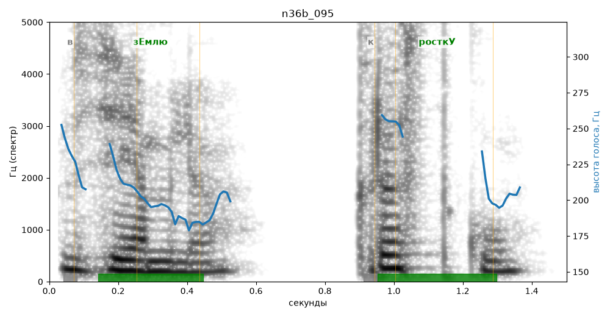

# n36b_095

Голос: **Барсик, сборка 36d** · длительность 1.5 с
Эталон: В землю. К ростку.
Распознано: В землю, кростку.
Расхождения в словах: «к ростку» → «кростку»

## Ударения
(где нужно: ruaccent)

| слово | нужно | у голоса | |
|---|---|---|---|
| землю | зЕмлю | зЕмлю | ✓ |
| ростку | росткУ | росткУ | ✓ |

## Интонация
- ✗ «в землю.» — конец фразы не понижается — звучит незаконченно / как перечисление
- ✓ «к ростку.» — конец фразы понижается — звучит законченно
- Диапазон голоса 5.6 полутонов (нормально), средняя высота 204 Гц

## Паузы и темп
- паузы на своих местах
- Темп 7.6 слога/с (быстро)

_Синяя линия — высота голоса. Над словами заглавная буква — где ударение должно быть; красным — голос поставил не туда (уверенно), оранжевым — возможно._
