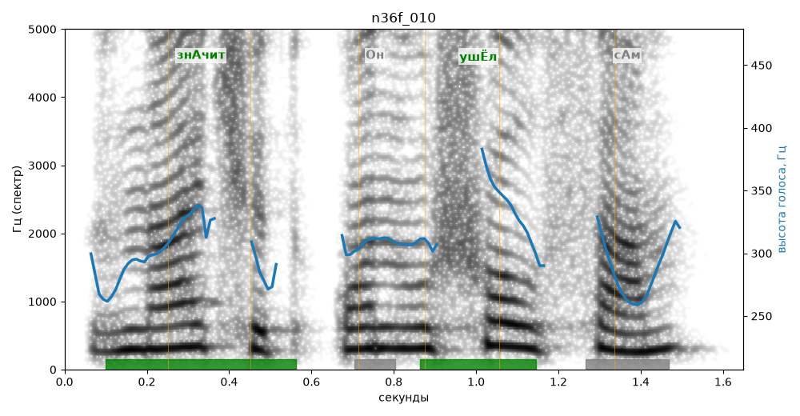

# n36f_010

Голос: **Филя, сборка 36d** · длительность 1.6 с
Эталон: Значит, он ушёл сам?
Распознано: Значит, он ушел сам.
Слова: все совпали

## Ударения
(где нужно: ruaccent)

| слово | нужно | у голоса | |
|---|---|---|---|
| значит | знАчит | знАчит | ✓ |
| ушёл | ушЁл | ушЁл | ✓ |

## Интонация
- ✗ «значит он ушёл сам?» — нет вопросительного подъёма (самое высокое место — «ушёл», в начале) — звучит как утверждение
- Диапазон голоса 4.8 полутонов (нормально), средняя высота 307 Гц

## Паузы и темп
- паузы на своих местах
- Темп 4.4 слога/с (нормально)

_Синяя линия — высота голоса. Над словами заглавная буква — где ударение должно быть; красным — голос поставил не туда (уверенно), оранжевым — возможно._
