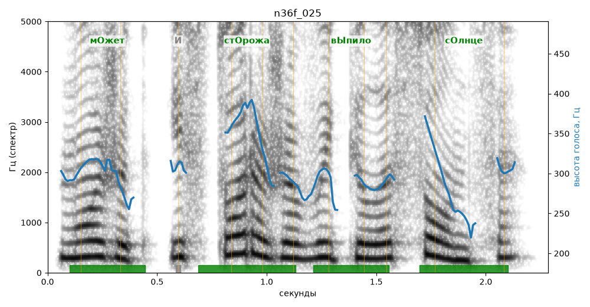

# n36f_025

Голос: **Филя, сборка 36d** · длительность 2.3 с
Эталон: Может, и сторожа выпило солнце?
Распознано: Может, и сторожа выпила солнце?
Расхождения в словах: «выпило» → «выпила»

## Ударения
(где нужно: ruaccent)

| слово | нужно | у голоса | |
|---|---|---|---|
| может | мОжет | мОжет | ✓ |
| сторожа | стОрожа | стОрожа | ✓ |
| выпило | вЫпило | вЫпило | ✓ |
| солнце | сОлнце | сОлнце | ✓ |

## Интонация
- ✓ «может и сторожа выпило солнце?» — вопросительный подъём на слове «сторожа»
- Диапазон голоса 6.7 полутонов (нормально), средняя высота 299 Гц

## Паузы и темп
- паузы на своих местах
- Темп 5.5 слога/с (нормально)

_Синяя линия — высота голоса. Над словами заглавная буква — где ударение должно быть; красным — голос поставил не туда (уверенно), оранжевым — возможно._
