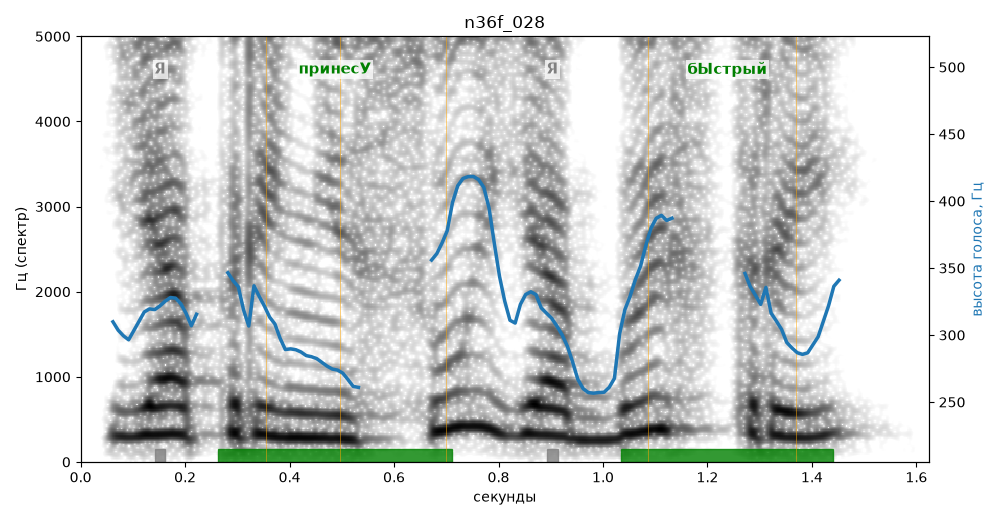

# n36f_028

Голос: **Филя, сборка 36d** · длительность 1.6 с
Эталон: Я принесу! Я быстрый!
Распознано: Я принесу, я быстрый.
Слова: все совпали

## Ударения
(где нужно: ruaccent)

| слово | нужно | у голоса | |
|---|---|---|---|
| принесу | принесУ | принесУ | ✓ |
| быстрый | бЫстрый | бЫстрый | ✓ |

## Интонация
- ✓ «я принесу!» — выделено слово «принесу» (+4.0 пт)
- Диапазон голоса 7.6 полутонов (живо), средняя высота 316 Гц

## Паузы и темп
- после «принесу!» пауза всего 0.18 с — фразы слипаются
- Темп 4.5 слога/с (нормально)

_Синяя линия — высота голоса. Над словами заглавная буква — где ударение должно быть; красным — голос поставил не туда (уверенно), оранжевым — возможно._
