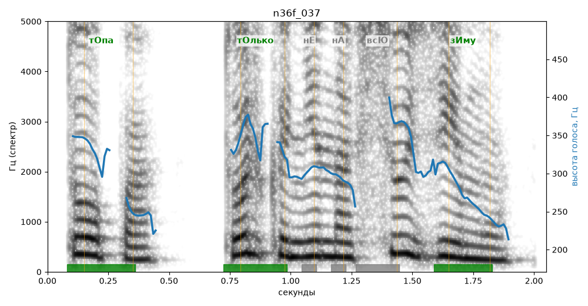

# n36f_037

Голос: **Филя, сборка 36d** · длительность 2.0 с
Эталон: Топа, только не на всю зиму!
Распознано: Топа, только не на всю зиму.
Слова: все совпали

## Ударения
(где нужно: ruaccent)

| слово | нужно | у голоса | |
|---|---|---|---|
| топа | тОпа | тОпа | ✓ |
| только | тОлько | тОлько | ✓ |
| зиму | зИму | зИму | ✓ |

## Интонация
- ✓ «топа только не на всю зиму!» — выделено слово «всю» (+3.0 пт)
- Диапазон голоса 7.9 полутонов (живо), средняя высота 303 Гц

## Паузы и темп
- паузы на своих местах
- Темп 6.5 слога/с (нормально)

_Синяя линия — высота голоса. Над словами заглавная буква — где ударение должно быть; красным — голос поставил не туда (уверенно), оранжевым — возможно._
