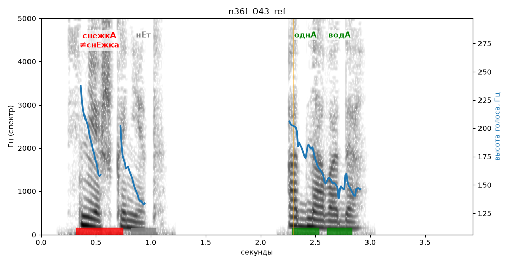

# n36f_043_ref

Голос: **edge:ru-RU-SvetlanaNeural** · длительность 3.9 с
Эталон: Снежка нет. Одна вода!
Распознано: Снешка нет. Одна вода.
Расхождения в словах: «снежка» → «снешка»

## Ударения
(где нужно: ruaccent)

| слово | нужно | у голоса | |
|---|---|---|---|
| снежка | снежкА | снЕжка | ✗ ОШИБКА |
| одна | однА | однА | ✓ |
| вода | водА | водА | ✓ |

## Интонация
- ✓ «снежка нет.» — конец фразы понижается — звучит законченно
- ✗ «одна вода!» — восклицание звучит ровно, без эмоции
- Диапазон голоса 6.9 полутонов (нормально), средняя высота 163 Гц

## Паузы и темп
- паузы на своих местах
- Темп 5.5 слога/с (нормально)

_Синяя линия — высота голоса. Над словами заглавная буква — где ударение должно быть; красным — голос поставил не туда (уверенно), оранжевым — возможно._
